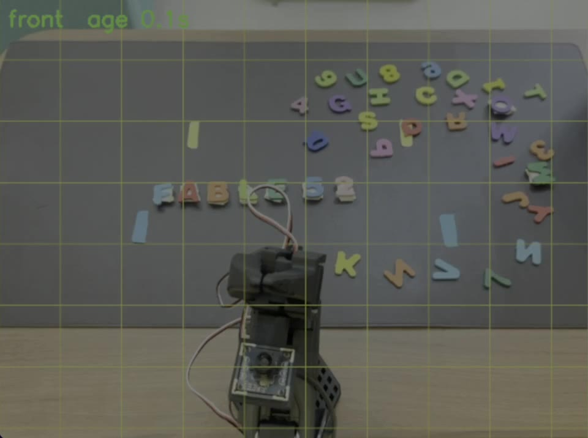

# so101-claude

**Talk to your SO-101 robot arm. Claude sees through two cameras and moves the arm. No training, no datasets.**

Tell Claude *"spell FABLE52 with the foam letters"* or *"put the red block in the bowl"* and it looks at the
table, works out where things are, and picks and places them, checking its own work as it goes.



*Claude (Fable 5.2) spelling **FABLE52** with foam letters on an SO-101, from the overhead camera.*

## How it works

```
 front camera ─┐                       ┌─> pick(x, y) / place(x, y) / move_to / ...
 wrist camera ─┴─> cameras.py ─> frames/ ─> server.py (MCP) <──> Claude Desktop
                                               │
                                               └─> LeRobot ─> SO-101 follower arm
```

- `server.py` is an [MCP](https://modelcontextprotocol.io) server. It gives Claude tools to **look** (camera
  images with a pixel grid) and to **act** (pick, place, move, open/close the gripper, go home).
- Claude reads an object's pixel in the overhead image. A one-time **table calibration** (touch the gripper to
  4 tape marks) maps pixels to table positions, and inverse kinematics on the official SO-101 URDF turns
  positions into joint moves.
- Safety is in the server, not left to the model: the gripper never goes below the table, moves are slow and
  smooth, joints stay inside their calibrated limits, and the gripper holds objects lightly instead of
  squeezing at full force.

## What you need

- An **SO-101 follower arm**, assembled and **calibrated with LeRobot**
  ([LeRobot SO-101 guide](https://huggingface.co/docs/lerobot/so101)). The leader arm is not needed.
- A **front camera** looking down at the table and the arm: a USB webcam, or an iPhone via Continuity Camera.
- A **wrist camera** on the gripper (recommended; used to check grasps and for precision mode).
- **4 small pieces of blue or yellow tape** to mark the table for calibration.
- The **Claude Desktop** app (macOS or Windows) and a Claude subscription.
- Python 3.12+ with **LeRobot 0.6 or newer** installed (the same environment you calibrated the arm with).

## Setup (about 15 minutes)

```bash
git clone https://github.com/omjambhale/so101-claude.git
cd so101-claude
conda activate lerobot            # or whichever environment has LeRobot
pip install -r requirements.txt
python setup_claude.py            # finds the arm's USB port + cameras, adds the robot to Claude Desktop
python tools/check_wrist_roll.py  # once, recommended: gives the wrist safe limits (Claude Desktop must be quit)
```

On macOS the first camera run asks Terminal for camera permission: allow it.

Then, every time you use it:

1. Start the cameras in their own Terminal window and leave it running:
   ```bash
   python cameras.py
   python preview.py              # optional: see what Claude sees (needs `pip install opencv-python`)
   ```
2. Put the arm in its folded rest pose and power it on.
3. Open Claude Desktop (quit and reopen it after setup) and say:
   **"Check the robot and help me calibrate the table."**

Claude walks you through the table calibration: stick the 4 tape marks on the table within the arm's reach and
spread out, hold the arm (its motors go limp), and touch the gripper tip to each mark, pointing straight down.
That's saved, and redone only if the front camera moves.

## Things to try

- "Pick up the blue letter and put it next to the red one."
- "Spell HELLO with the foam letters in a straight line at the bottom of the mat."
- "Sort the blocks by colour into the left and right side of the table."
- "Tidy the desk: put everything into the box."

More in [examples/PROMPTS.md](examples/PROMPTS.md).

## Tools Claude gets

| Tool | What it does |
|---|---|
| `get_state` | Joint angles, gripper position, whether the table is calibrated |
| `look` | Latest front or wrist image, with an optional pixel grid or 3x zoom |
| `pick` / `place` | Pick the object at a pixel of the front image; place it at another pixel |
| `move_to`, `turn_wrist`, `set_gripper` | Small corrections |
| `go_home`, `set_home` | Return to / save the rest pose |
| `calibration_start` / `_add_point` / `_finish` / `_cancel` | Table calibration |
| `calibrate_jaw_target`, `set_jaw_target`, `center_on`, `grab_here`, `put_down` | Precision mode: lines objects up using the wrist camera (for tight placing like spelling) |
| `diagnose` | Read-only motor health check (temperature, load, errors) |

## Safety

- Keep a hand near the arm's power plug the first few times. **Unplugging power is always a safe stop.**
- `calibration_start` makes **all motors go limp**. Hold the arm before Claude calls it.
- If a motor buzzes, gets hot or pushes against something: stop, unplug power, and ask Claude to run `diagnose`.
- Claude asks before big moves, but it is a real machine: keep fingers, cables and fragile things out of the way.

## Troubleshooting

See [docs/TROUBLESHOOTING.md](docs/TROUBLESHOOTING.md). The most common issues:

- **"Camera frames are stale"**: `cameras.py` isn't running, or a camera index changed (re-run `setup_claude.py`).
- **Picks land a bit off**: the front camera moved. Ask Claude to redo the table calibration.
- **The wrist only follows part of its turn / buzzes near one end**: run `python tools/check_wrist_roll.py`.
- **"Port busy" / can't connect**: only one program can use the arm. Quit Claude Desktop before running
  LeRobot teleop or the tools in `tools/`.

## Files

```
server.py            MCP server (the tools above)
kinematics.py        forward / inverse kinematics from the SO-101 URDF (numpy only)
cameras.py           camera daemon -> frames/
preview.py           live view of the cameras
setup_claude.py      one-time setup
config.py            settings (config.json is yours and never committed)
tools/check_wrist_roll.py   fixes the wrist-roll rollover problem
assets/              SO-101 URDF (Apache-2.0, TheRobotStudio)
```

## Credits

- [LeRobot](https://github.com/huggingface/lerobot) by Hugging Face, and the SO-101 by
  [TheRobotStudio](https://github.com/TheRobotStudio/SO-ARM100).
- Built with Claude.

## License

MIT. The SO-101 URDF in `assets/` is Apache-2.0 (see `assets/NOTICE.md`).
